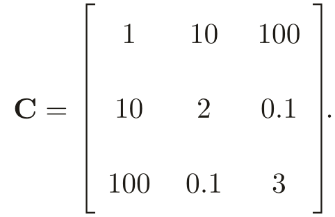
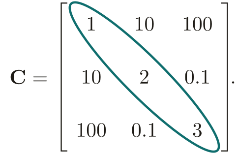
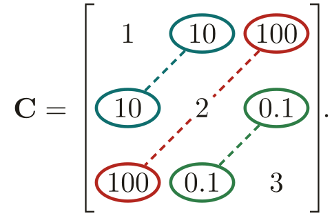
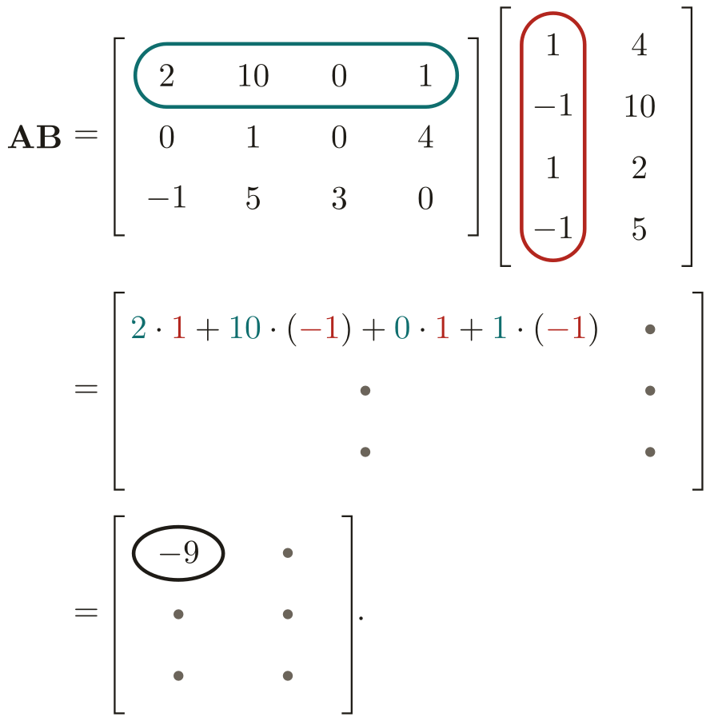
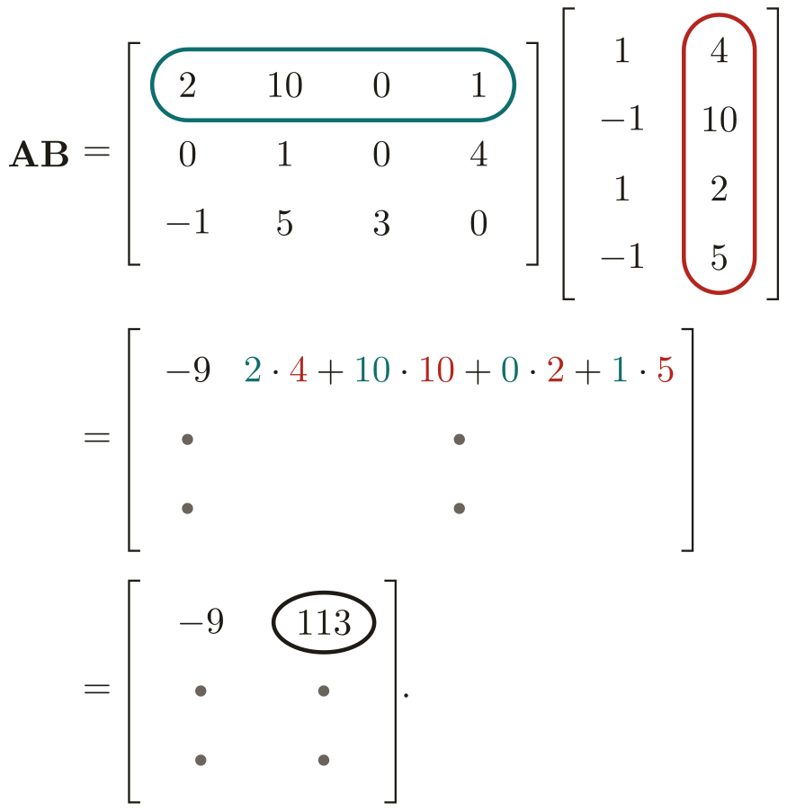

# Linear algebra {#sec-linear-algebra}

```{r setup_linear_algebra}
#| message: false
source("_common.R")
```

```{r vector_helpers}
# Shared pieces for the vector figures in this chapter (draw_vector() and
# origin_axes() live in _common.R). NB: the figure chunks are cached on their
# own code, so clear linear_algebra_cache/ after editing these helpers.

# Side-by-side panels labelled (a), (b), ... in the house font, with a top
# margin on each plot so the label clears the top tick label.
panels <- function(...) {
  plots <- lapply(list(...), \(p) p + theme(plot.margin = margin(22, 6, 6, 6)))
  plot_grid(
    plotlist = plots,
    nrow = 1,
    labels = paste0("(", letters[seq_along(plots)], ")"),
    label_fontfamily = "Archivo",
    label_fontface = "plain",
    label_colour = mfpa$ink,
    label_size = 13
  )
}
```

*Some material in this chapter is adapted from notes [Hye Young You](https://hyeyoungyou.com) wrote for the math boot camp for the political science PhD program at Vanderbilt.*

Linear algebra is an essential tool for understanding multivariate statistics.
My main goal here is for you to get familiar with the basics of vector and matrix notation, and the use of matrices to solve linear systems.
You are probably already familiar with matrices, at least informally.
The typical data set---each row an observation, each column a variable---is formatted like a matrix.

As with all of our topics, but perhaps to an even greater degree here, we will only cover a light introduction.
Linear algebra goes very deep.
If you want to learn more, I recommend starting with MIT's freely available [undergraduate course](https://ocw.mit.edu/courses/18-06-linear-algebra-spring-2010/).


## Vectors {#sec-vectors}

A [vector]{.concept definition="An ordered array. A vector $\mathbf{v}$ of $k$ elements is written $\mathbf{v} = (v_1, v_2, \ldots, v_k)$. If its elements are real numbers, we write $\mathbf{v} \in \mathbb{R}^k$."} is an ordered list of numbers.
To denote a vector $\mathbf{v}$ of $k$ elements, we write $\mathbf{v} = (v_1, v_2, \ldots, v_k)$, or sometimes
$$
\mathbf{v} = \begin{pmatrix} v_1 \\ v_2 \\ \vdots \\ v_k \end{pmatrix}.
$$

Notice the convention of using a lowercase bold letter to denote a vector.
When I write vectors on the whiteboard, I will instead denote them with an arrow, like $\vec{v}$.
We will usually be dealing with vectors of real numbers.
To denote the fact that $\mathbf{v}$ is a vector of $k$ real numbers, we write $\mathbf{v} \in \mathbb{R}^k$.

You can think of a vector $\mathbf{v} \in \mathbb{R}^k$ as a point in $k$-dimensional space.
More often, it's convenient---for reasons we'll see in just a second---to portray the vector as an arrow pointing from the origin to the given coordinates in $k$-dimensional space.
I personally have a lot of trouble visualizing in more than two dimensions, so I'm going to illustrate all the concepts here with vectors in $\mathbb{R}^2$.

```{r}
#| label: fig-vectors-as-arrows
#| fig-cap: "Vectors in $\\mathbb{R}^2$ illustrated as arrows pointing out from the origin."
#| fig-asp: 0.7
#| cache: true
ggplot() +
  origin_axes() +
  draw_vector(2, 3) +
  draw_vector(3, 2, colour = mfpa$red) +
  draw_vector(-2, 3, colour = mfpa$green) +
  draw_vector(-3, -2, colour = mfpa$muted) +
  draw_vector(2, -1, colour = mfpa$ink) +
  label_curve(2.1, 3.25, "(2, 3)", parse = FALSE, hjust = 0) +
  label_curve(3.15, 2, "(3, 2)", colour = mfpa$red, parse = FALSE, hjust = 0) +
  label_curve(-2.1, 3.25, "(−2, 3)", colour = mfpa$green, parse = FALSE, hjust = 1) +
  label_curve(-3.15, -2, "(−3, −2)", colour = mfpa$muted, parse = FALSE, hjust = 1) +
  label_curve(2.15, -1, "(2, −1)", colour = mfpa$ink, parse = FALSE, hjust = 0) +
  scale_x_continuous(breaks = -3:3) +
  scale_y_continuous(breaks = -2:3) +
  coord_equal(xlim = c(-4.6, 4.6), ylim = c(-2.6, 3.6)) +
  labs(x = NULL, y = NULL)
```

A vector may seem like a set, but it's not exactly.
In a vector, unlike a set, order matters: the 2-dimensional vectors $(2, 3)$ and $(3, 2)$ are legitimately different, whereas the sets $\{2, 3\}$ and $\{3, 2\}$ are exactly the same.

A vector can be multiplied by a scalar $c \in \mathbb{R}$.
Algebraically, this works by just multiplying element-by-element:
$$
c \mathbf{v} = \begin{pmatrix} c v_1 \\ c v_2 \\ \vdots \\ c v_k \end{pmatrix}.
$$
If $c$ is positive, this looks like an expansion of the vector by a factor of $c$ (or contraction if $c < 1$).
The logic is similar for negative $c$, except that first the vector is reflected about the origin.

```{r}
#| label: fig-vector-scaling
#| fig-cap: "Scalar multiplication of the vector $\\mathbf{v} = (1, 2)$."
#| fig-width: 4.5
#| fig-asp: 1.15
#| fig-align: center
#| cache: true
ggplot() +
  origin_axes() +
  draw_vector(2, 4, colour = mfpa$red) +    # 2v, drawn first so v sits on top
  draw_vector(1, 2) +                       # v
  draw_vector(-1, -2, colour = mfpa$green) + # -v
  draw_vector(0.5, 1, colour = mfpa$ink) +  # (1/2)v, drawn last so its head shows on v's shaft
  label_curve(0.55, 1.5, "bold(v)", hjust = 1) +
  label_curve(0.65, 0.8, '"½"*bold(v)', colour = mfpa$ink, hjust = 0) +
  label_curve(2.15, 4, '"2"*bold(v)', colour = mfpa$red, hjust = 0) +
  label_curve(-1.3, -2.05, '"−"*bold(v)', colour = mfpa$green, hjust = 1) +
  scale_x_continuous(breaks = -2:3) +
  scale_y_continuous(breaks = seq(-2, 4, by = 2)) +
  coord_equal(xlim = c(-2.5, 3.2), ylim = c(-2.5, 4.5)) +
  labs(x = NULL, y = NULL)
```

Vector addition also works element-by-element:
$$
\mathbf{u} + \mathbf{v} = \begin{pmatrix}
  u_1 + v_1 \\ u_2 + v_2 \\ \vdots \\ u_k + v_k
\end{pmatrix}.
$$
This is why it's convenient to represent vectors as arrows, not just as points in space.
If you take the vector $\mathbf{u}$ and start it at the end of $\mathbf{v}$ rather than at the origin, you end up with $\mathbf{u} + \mathbf{v}$.

```{r}
#| label: fig-vector-addition
#| fig-cap: "Addition of the vectors $\\mathbf{v} = (1, 2)$ and $\\mathbf{u} = (3, 1)$."
#| fig-asp: 0.7
#| cache: true
ggplot() +
  origin_axes() +
  draw_vector(4, 3, x = 3, y = 1, colour = mfpa$red, head = FALSE, alpha = 0.35) + # v, from the tip of u
  draw_vector(4, 3, x = 1, y = 2, head = FALSE, alpha = 0.35) +       # u, from the tip of v
  draw_vector(3, 1) +                                                # u
  draw_vector(1, 2, colour = mfpa$red) +                             # v
  draw_vector(4, 3, colour = mfpa$green) +                           # u + v
  label_curve(3.15, 0.85, "bold(u)", hjust = 0) +
  label_curve(0.9, 2.25, "bold(v)", colour = mfpa$red, hjust = 0.5) +
  label_curve(4.1, 3.2, 'bold(u)*" + "*bold(v)', colour = mfpa$green, hjust = 0) +
  scale_x_continuous(breaks = 0:4) +
  scale_y_continuous(breaks = 0:3) +
  coord_equal(xlim = c(-0.5, 5.6), ylim = c(-0.5, 3.5)) +
  labs(x = NULL, y = NULL)
```

A special vector is the [zero vector]{.concept definition="The vector whose entries are all zeroes. We write $\mathbf{0}_k$ for the zero vector of length $k$, or just $\mathbf{0}$ when the length is clear from the context."}, which contains---you guessed it---all zeroes.
We write $\mathbf{0}_k$ to denote the zero vector of length $k$.
When the length of the zero vector is clear from the context, we may just write $\mathbf{0}$.

The last important vector operation is the [dot product]{.concept definition="The dot product of $\mathbf{u}$ and $\mathbf{v}$, written $\mathbf{u} \cdot \mathbf{v}$, is the sum of the products of the entries: $\mathbf{u} \cdot \mathbf{v} = u_1 v_1 + u_2 v_2 + \cdots + u_k v_k$."}.
The dot product of $\mathbf{u}$ and $\mathbf{v}$, written $\mathbf{u} \cdot \mathbf{v}$, is the sum of the products of the entries:
$$
\mathbf{u} \cdot \mathbf{v}
=
u_1 v_1 + u_2 v_2 + \cdots + u_k v_k
=
\sum_{m=1}^k u_m v_m.
$$
The dot product of two vectors is always a [scalar]{.concept definition="A regular number, which you can think of as a 1-dimensional vector if you want to be pretentious."}, i.e., a single ordinary number.
Since the dot product notation for vectors looks like the same notation as multiplication for scalars, you may be tempted to think that $\mathbf{u} \cdot \mathbf{v}$ will be a vector of element-by-element multiples.
Resist the temptation.

The dot product of two vectors is closely related to the angle between them.
Being more specific than that would get us into more geometry, and soon thereafter trigonometry, than I want to do here.
So I will just observe that a pair of vectors has a dot product of 0 exactly when they are [orthogonal]{.concept definition="The vectors $\mathbf{u}$ and $\mathbf{v}$ are orthogonal if $\mathbf{u} \cdot \mathbf{v} = 0$, which is true precisely when they are perpendicular to each other."}, meaning they are perpendicular to each other.

```{r}
#| label: fig-orthogonal-vectors
#| fig-cap: "The vectors $(1, 4)$ and $(4, -1)$ have a dot product of 0 and are orthogonal."
#| fig-width: 4.5
#| fig-asp: 1
#| fig-align: center
#| cache: true
# Right-angle marker: a small square in the corner between the two vectors,
# built from their unit directions.
u_hat <- c(1, 4) / sqrt(17)
v_hat <- c(4, -1) / sqrt(17)
s <- 0.4
corner <- rbind(s * u_hat, s * (u_hat + v_hat), s * v_hat)

ggplot() +
  origin_axes() +
  annotate("path", x = corner[, 1], y = corner[, 2], colour = mfpa$muted, linewidth = 0.7) +
  draw_vector(1, 4) +
  draw_vector(4, -1, colour = mfpa$red) +
  label_curve(1.15, 4, "(1, 4)", parse = FALSE, hjust = 0) +
  label_curve(4.15, -1, "(4, −1)", colour = mfpa$red, parse = FALSE, hjust = 0) +
  scale_x_continuous(breaks = 0:4) +
  scale_y_continuous(breaks = -1:4) +
  coord_equal(xlim = c(-0.8, 5.6), ylim = c(-1.6, 4.5)) +
  labs(x = NULL, y = NULL)
```

::: {#exr-orthogonal-vectors name="Orthogonal vectors"}
Find two different vectors that are both orthogonal to $\mathbf{v} = (1, 3, 2)$.

:::: {.answer}
There are infinitely many answers here, but here are a couple.
The vector $(3, -1, 0)$ is orthogonal:
$$
\begin{pmatrix} 1 \\ 3 \\ 2 \end{pmatrix}
\cdot
\begin{pmatrix} 3 \\ -1 \\ 0 \end{pmatrix}
= 1 \cdot 3 + 3 \cdot (-1) + 2 \cdot 0
= 0.
$$
So is the vector $(-3, 1, 0)$:
$$
\begin{pmatrix} 1 \\ 3 \\ 2 \end{pmatrix}
\cdot
\begin{pmatrix} -3 \\ 1 \\ 0 \end{pmatrix}
= 1 \cdot (-3) + 3 \cdot 1 + 2 \cdot 0
= 0.
$$
In fact, once we showed that $(3, -1, 0)$ was orthogonal, it turns out that *any* scalar multiple of it is also orthogonal, as covered in the exercise below.
::::
:::

::: {#exr-scalar-multiple-dot-product name="Dot product of a scalar multiple"}
Let $\mathbf{u}$ and $\mathbf{v}$ be vectors of the same length, and let $a$ and $b$ be scalars.
Show that $a \mathbf{u} \cdot b \mathbf{v} = a b (\mathbf{u} \cdot \mathbf{v})$.
Using this fact, show that if $\mathbf{u}$ and $\mathbf{v}$ are orthogonal, then so are $a \mathbf{u}$ and $b \mathbf{v}$.

:::: {.answer}
Using the definition of scalar multiplication and the dot product, we have
$$
\begin{aligned}
a \mathbf{u} \cdot b \mathbf{v}
&= \begin{pmatrix} a u_1 \\ a u_2 \\ \vdots \\ a u_k \end{pmatrix} \cdot \begin{pmatrix} b v_1 \\ b v_2 \\ \vdots \\ b v_k \end{pmatrix} \\
&= \sum_{m=1}^k (a u_m) (b v_m) \\
&= \sum_{m=1}^k a b u_m v_m \\
&= a b \sum_{m=1}^k u_m v_m \\
&= a b (\mathbf{u} \cdot \mathbf{v}).
\end{aligned}
$$
If $\mathbf{u}$ and $\mathbf{v}$ are orthogonal, then we have $\mathbf{u} \cdot \mathbf{v} = 0$.
Therefore, $a \mathbf{u} \cdot b \mathbf{v} = ab \cdot 0 = 0$, so $a \mathbf{u}$ and $b \mathbf{v}$ are orthogonal as well.
::::
:::


## Linear independence {#sec-linear-independence}

An important concept for regression analysis is the linear independence of a collection of vectors.
In essence, to run a regression on a set of variables, you need each column to carry some new information that none of the others already captures.
Linear independence formalizes this concept.

::: {#def-linear-independence name="Linear independence"}
A collection of vectors $\mathbf{v}_1, \ldots, \mathbf{v}_J$ is [linearly independent]{.concept entry="Linear independence" definition="The vectors $\mathbf{v}_1, \ldots, \mathbf{v}_J$ are linearly independent if the only solution to $c_1 \mathbf{v}_1 + \cdots + c_J \mathbf{v}_J = \mathbf{0}$ is $c_1 = 0, \ldots, c_J = 0$. Otherwise, they are linearly dependent."} if the only solution to
$$
c_1 \mathbf{v}_1 + \cdots + c_J \mathbf{v}_J = \mathbf{0}
$$
is $c_1 = 0, \ldots, c_J = 0$.
Otherwise, we call the vectors [linearly dependent]{.concept entry="Linear independence"}.
:::

As an example, consider the pair of vectors
$$
\mathbf{v}_1 = \begin{pmatrix} 1 \\ 0 \end{pmatrix},
\quad
\mathbf{v}_2 = \begin{pmatrix} 0 \\ 1 \end{pmatrix}.
$$
To check whether they are linearly independent, we need to find every pair of numbers $c_1$ and $c_2$ that makes $c_1 \mathbf{v}_1 + c_2 \mathbf{v}_2 = \mathbf{0}$.
Working entry by entry:
$$
\begin{aligned}
c_1 \mathbf{v}_1 + c_2 \mathbf{v}_2 = \mathbf{0}
&\quad \Leftrightarrow \quad
\begin{pmatrix} c_1 \cdot 1 + c_2 \cdot 0 \\ c_1 \cdot 0 + c_2 \cdot 1 \end{pmatrix}
= \begin{pmatrix} 0 \\ 0 \end{pmatrix} \\
&\quad \Leftrightarrow \quad
\begin{pmatrix} c_1 \\ c_2 \end{pmatrix}
= \begin{pmatrix} 0 \\ 0 \end{pmatrix}.
\end{aligned}
$$
The only solution is $c_1 = c_2 = 0$, so these vectors are linearly independent.

As an example of two linearly *dependent* vectors, consider
$$
\mathbf{v}_1 = \begin{pmatrix} 1 \\ 2 \end{pmatrix},
\quad
\mathbf{v}_2 = \begin{pmatrix} 2 \\ 4 \end{pmatrix}.
$$
To show that they're linearly dependent, we just need to find any pair of coefficients to put on them that makes their sum equal $(0, 0)$.
Since $\mathbf{v}_2 = 2 \mathbf{v}_1$, the coefficients $c_1 = 2$ and $c_2 = -1$ will work:
$$
2 \mathbf{v}_1 + (-1) \mathbf{v}_2
= \begin{pmatrix} 2 \cdot 1 + (-1) \cdot 2 \\ 2 \cdot 2 + (-1) \cdot 4 \end{pmatrix}
= \begin{pmatrix} 2 - 2 \\ 4 - 4 \end{pmatrix}
= \begin{pmatrix} 0 \\ 0 \end{pmatrix}.
$$

Some fun facts about linear independence:

- If any vector in $\mathbf{v}_1, \ldots, \mathbf{v}_J$ is a [linear combination]{.concept definition="The vector $\mathbf{u}$ is a linear combination of $\mathbf{v}_1, \ldots, \mathbf{v}_J$ if there are real numbers $c_1, \ldots, c_J$ such that $\mathbf{u} = c_1 \mathbf{v}_1 + \cdots + c_J \mathbf{v}_J$."} of the others, meaning it can be written as a weighted sum of the others (i.e., $\mathbf{v}_j = \sum_{i \neq j} c_i \mathbf{v}_i$ for some real numbers $c_i$), then these vectors are linearly dependent.

- A collection of $J$ vectors of length $k$ cannot be linearly independent if $J > k$.
  In other words, given vectors of length $k$, the most that can be linearly independent of each other is $k$.

- If any $\mathbf{v}_j = \mathbf{0}$, then $\mathbf{v}_1, \ldots, \mathbf{v}_J$ are linearly dependent.
  (Why?)

::: {#exr-linear-dependence-zero-vector name="Zero vector is always linearly dependent"}
Explain why a collection of vectors is linearly dependent if any one of them is a zero vector.

:::: {.answer}
Consider a collection $\mathbf{v}_1, \ldots, \mathbf{v}_J$ where some $\mathbf{v}_j = \mathbf{0}$.
Set the coefficient on $\mathbf{v}_j$ to 1 and every other coefficient to 0:
$$
c_1 = 0, \; \ldots, \; c_{j-1} = 0, \quad c_j = 1, \quad c_{j+1} = 0, \; \ldots, \; c_J = 0.
$$
Then every term drops out except the $j$'th one, so
$$
c_1 \mathbf{v}_1 + \cdots + c_j \mathbf{v}_j + \cdots + c_J \mathbf{v}_J
= \mathbf{v}_j
= \mathbf{0}.
$$
Because $c_j = 1$ is not zero, this is a solution other than all zeroes, so the vectors are linearly dependent.
::::
:::

For a collection of two vectors in two-dimensional space, linear dependence has a simple geometric interpretation.
The two vectors are linearly dependent exactly when they lie on a common line through the origin, as in panel (a) of @fig-linear-independence.
If the two vectors don't lie on a common line, as in panel (b), neither one is a scalar multiple of the other, and they are linearly independent.

```{r}
#| label: fig-linear-independence
#| fig-cap: "A linearly dependent pair of vectors in $\\mathbb{R}^2$ (a) and a linearly independent pair (b)."
#| fig-asp: 0.45
#| cache: true
p_dependent <- ggplot() +
  origin_axes() +
  geom_abline(slope = 1 / 2, intercept = 0, colour = mfpa$muted) +
  draw_vector(2, 1) +
  draw_vector(-4, -2, colour = mfpa$red) +
  label_curve(1.7, 1.5, "bold(v)[1]", hjust = 0.5) +
  label_curve(-4, -1.55, "bold(v)[2]", colour = mfpa$red, hjust = 0.5) +
  scale_x_continuous(breaks = seq(-4, 2, by = 2)) +
  scale_y_continuous(breaks = -2:2) +
  coord_equal(xlim = c(-4.5, 3), ylim = c(-2.5, 2.5)) +
  labs(x = NULL, y = NULL)

p_independent <- ggplot() +
  origin_axes() +
  draw_vector(2, 1) +
  draw_vector(1, 2, colour = mfpa$red) +
  label_curve(2.15, 1, "bold(v)[1]", hjust = 0) +
  label_curve(1, 2.3, "bold(v)[2]", colour = mfpa$red, hjust = 0.5) +
  scale_x_continuous(breaks = 0:2) +
  scale_y_continuous(breaks = 0:2) +
  coord_equal(xlim = c(-0.5, 2.8), ylim = c(-0.5, 2.6)) +
  labs(x = NULL, y = NULL)

panels(p_dependent, p_independent)
```

::: {#exr-linear-independence-examples name="Checking linear independence"}
Determine whether each of the following collections of vectors is linearly independent.

(a) $\mathbf{v}_1 = \begin{pmatrix} 1 \\ 2 \\ 3 \end{pmatrix}, \mathbf{v}_2 = \begin{pmatrix} 2 \\ 4 \\ 6 \end{pmatrix}$.

(b) $\mathbf{v}_1 = \begin{pmatrix} 1 \\ 2 \\ 3 \end{pmatrix}, \mathbf{v}_2 = \begin{pmatrix} 1 \\ 4 \\ 9 \end{pmatrix}$.

(c) $\mathbf{v}_1 = \begin{pmatrix} 1 \\ 1 \\ 1 \end{pmatrix}, \mathbf{v}_2 = \begin{pmatrix} 0 \\ 1 \\ 0 \end{pmatrix}, \mathbf{v}_3 = \begin{pmatrix} 0 \\ 0 \\ 1 \end{pmatrix}$.

(d) $\mathbf{v}_1 = \begin{pmatrix} 1 \\ 0 \\ 0 \end{pmatrix}, \mathbf{v}_2 = \begin{pmatrix} 14 \\ 12 \\ 0 \end{pmatrix}, \mathbf{v}_3 = \begin{pmatrix} 0 \\ -1 \\ 0 \end{pmatrix}$.

:::: {.answer}
(a) Linearly dependent: $2 \mathbf{v}_1 - \mathbf{v}_2 = \mathbf{0}$.

(b) Linearly independent:
    $$
    \begin{aligned}
    & c_1 \mathbf{v}_1 + c_2 \mathbf{v}_2
    = \begin{pmatrix} c_1 + c_2 \\ 2 c_1 + 4 c_2 \\ 3 c_1 + 9 c_2 \end{pmatrix}
    = \mathbf{0} \\
    & \quad \Rightarrow \quad c_1 = -c_2 \text{ and } 2 c_2 = 0 \\
    & \quad \Rightarrow \quad c_1 = c_2 = 0.
    \end{aligned}
    $$

(c) Linearly independent:
    $$
    c_1 \mathbf{v}_1 + c_2 \mathbf{v}_2 + c_3 \mathbf{v}_3
    = \begin{pmatrix} c_1 \\ c_1 + c_2 \\ c_1 + c_3 \end{pmatrix}
    = \mathbf{0}
    \quad \Rightarrow \quad
    c_1 = c_2 = c_3 = 0.
    $$

(d) Linearly dependent: $14 \mathbf{v}_1 - \mathbf{v}_2 - 12 \mathbf{v}_3 = \mathbf{0}$.
::::
:::

## Matrices {#sec-matrices}

You may not have known it, but vectors have given us a compact way to write regression-style equations.
Think of a linear model, where we model an outcome $y_i$ as a linear function of $k$ variables $x_{i1}, x_{i2}, \ldots, x_{ik}$, in addition to an error term $\varepsilon_i$.
You can write down the model using the ambiguous, imprecise "dot-dot-dot" notation
$$
y_i = \beta_1 x_{i1} + \beta_2 x_{i2} + \cdots + \beta_k x_{ik} + \varepsilon_i.
$$
You can upgrade that to the cumbersome-but-more-pedagogically-correct summation notation
$$
y_i = \sum_{m=1}^k \beta_m x_{im} + \varepsilon_i.
$$
But hey, that summation looks a lot like a dot product.
And indeed, we can write the linear model for a single observation even more compactly using the vector notation
$$
y_i = \mathbf{x}_i \cdot \boldsymbol{\beta} + \varepsilon_i,
$$
where $\mathbf{x}_i \in \mathbb{R}^k$ is the vector of variables and $\boldsymbol{\beta} \in \mathbb{R}^k$ is the vector of coefficients.

The vector notation just gives us a way to write the model for a single observation.
When we expand out to matrices, we'll be able to go even further---to write a single equation to stand for the model of all the data.
In other words, if we think of there being $n$ observations, we'll be able to write a single equation that collects all of the observation-by-observation models
$$
\begin{aligned}
y_1 &= \beta_1 x_{11} + \beta_2 x_{12} + \cdots + \beta_k x_{1k} + \varepsilon_1; \\
y_2 &= \beta_1 x_{21} + \beta_2 x_{22} + \cdots + \beta_k x_{2k} + \varepsilon_2; \\
&\;\;\vdots \\
y_n &= \beta_1 x_{n1} + \beta_2 x_{n2} + \cdots + \beta_k x_{nk} + \varepsilon_n.
\end{aligned}
$$

A [matrix]{.concept definition="A two-dimensional array of numbers, with entries in rows and columns. A matrix with $n$ rows and $k$ columns is an $n \times k$ matrix. We write $\mathbf{A} \in \mathbb{R}^{n \times k}$ to denote that $\mathbf{A}$ is an $n \times k$ matrix. We usually write $a_{ij}$ for the entry of $\mathbf{A}$ in the $i$'th row and $j$'th column."} is a two-dimensional array of numbers, with entries in rows and columns.
We call a matrix with $n$ rows and $k$ columns an $n \times k$ matrix.
Here's an example of a $2 \times 3$ matrix:
$$
\mathbf{A}
=
\begin{bmatrix}
  99 & 73 & 2 \\
  13 & 40 & 41
\end{bmatrix}
$$
Notice the convention of using an uppercase bold letter to denote a matrix.
Given a matrix $\mathbf{A}$, we usually write $a_{ij}$ to denote the entry in the $i$'th row and $j$'th column.
In the above example, we have $a_{13} = 2$.

Additionally, mirroring our $\mathbb{R}^k$ notation for the set of length-$k$ vectors, we write $\mathbb{R}^{n \times k}$ to denote the set of $n \times k$ matrices.
So for example, with the $2 \times 3$ example matrix $\mathbf{A}$ above, we would write $\mathbf{A} \in \mathbb{R}^{2 \times 3}$.

You can think of a vector $\mathbf{v} \in \mathbb{R}^k$ as a $1 \times k$ [row vector]{.concept entry="Row and column vectors" definition="A $k$-dimensional vector $\mathbf{v} \in \mathbb{R}^k$ may be treated as a $1 \times k$ matrix, in which case we call it a row vector, or as a $k \times 1$ matrix, in which case we call it a column vector. I personally default to treating vectors as column vectors."} or as a $k \times 1$ [column vector]{.concept entry="Row and column vectors"}.
Whenever I use a vector alongside matrices, you can assume I am treating it as a column vector, unless I specifically say otherwise.

### Basic matrix operations {#sec-matrix-operations}

Like vectors, matrices can be multiplied by scalars.
Given a scalar $c \in \mathbb{R}$ and a matrix $\mathbf{A} \in \mathbb{R}^{n \times k}$, we have
$$
c \mathbf{A} =
\begin{bmatrix}
  c a_{11} & c a_{12} & \cdots & c a_{1k} \\
  c a_{21} & c a_{22} & \cdots & c a_{2k} \\
  \vdots & \vdots & \ddots & \vdots \\
  c a_{n1} & c a_{n2} & \cdots & c a_{nk}
\end{bmatrix}
$$

Matrix addition also works just like vector addition.
Given two matrices of the same dimensions, $\mathbf{A} \in \mathbb{R}^{n \times k}$ and $\mathbf{B} \in \mathbb{R}^{n \times k}$, we have
$$
\mathbf{A} + \mathbf{B} =
\begin{bmatrix}
  a_{11} + b_{11} & a_{12} + b_{12} & \cdots & a_{1k} + b_{1k} \\
  a_{21} + b_{21} & a_{22} + b_{22} & \cdots & a_{2k} + b_{2k} \\
  \vdots & \vdots & \ddots & \vdots \\
  a_{n1} + b_{n1} & a_{n2} + b_{n2} & \cdots & a_{nk} + b_{nk} \\
\end{bmatrix}
$$
Addition of matrices of different dimensions is not well-defined.
In other words, if you have $\mathbf{A} \in \mathbb{R}^{n \times k}$ and $\mathbf{B} \in \mathbb{R}^{m \times \ell}$, where $n \neq m$ or $k \neq \ell$ (or both), then you're just talking mathematical nonsense if you write $\mathbf{A} + \mathbf{B}$.

Sometimes you will want to "rotate" an $n \times k$ matrix into a $k \times n$ one, so that the first row becomes the first column, the second row becomes the second column, and so on.
This is called the [transpose]{.concept definition="The transpose of an $n \times k$ matrix $\mathbf{A}$, written $\mathbf{A}^\top$ (or $\mathbf{A}'$), is the $k \times n$ matrix whose first column is the first row of $\mathbf{A}$, whose second column is the second row of $\mathbf{A}$, and so on."}.
I write the transpose of $\mathbf{A}$ as $\mathbf{A}^\top$, though you will often also see it written $\mathbf{A}'$.
For example:
$$
\mathbf{A}
=
\begin{bmatrix}
  99 & 73 & 2 \\
  13 & 40 & 41
\end{bmatrix}
\qquad
\Leftrightarrow
\qquad
\mathbf{A}^\top =
\begin{bmatrix}
  99 & 13 \\
  73 & 40 \\
  2 & 41
\end{bmatrix}.
$$
Some of the most commonly invoked properties of the transpose are:
$$
\begin{aligned}
(\mathbf{A}^\top)^\top &= \mathbf{A}, \\
(c \mathbf{A})^\top &= c \mathbf{A}^\top, \\
(\mathbf{A} + \mathbf{B})^\top &= \mathbf{A}^\top + \mathbf{B}^\top.
\end{aligned}
$$

### Special matrices {#sec-special-matrices}

There are some categories of matrix that come up often enough that we have special names for them.
We will end up spending a lot of time working with matrices where the number of rows matches the number of columns.
These are called [square matrices]{.concept entry="Square matrix" definition="A matrix with the same number of rows as columns, i.e., an $n \times n$ matrix."}.

::: {#def-square-matrix name="Square matrix"}
A matrix is [square]{.concept entry="Square matrix"} if it has the same number of rows as columns: $\mathbf{A} \in \mathbb{R}^{n \times n}$ for some natural number $n$.
:::

Square matrices get their names because, well, they often look like squares.
For example, the $3 \times 3$ matrix
$$
\mathbf{A} = \begin{bmatrix}
10 & 20 & 40 \\
30 & 60 & 70 \\
40 & 20 & 90
\end{bmatrix}
$$
Of course, what really matters is that the number of rows match the number of columns, not that the written-out matrix look like a square.
The $2 \times 2$ matrix
$$
\mathbf{B} = \begin{bmatrix}
0.123456789012345678901234 & 1.2345678901234567890123456 \\
2.345678901234567890123456 & 5.6789012345678901234567890
\end{bmatrix}
$$
may "look" like a rectangle, but I assure you that it is square.

We'll also often be interested in the subcategory of square matrices that are [symmetric]{.concept entry="Symmetric matrix" definition="A matrix that is equal to its transpose: $\mathbf{A} = \mathbf{A}^\top$."}.
The distinguishing feature of a symmetric matrix is that the entry in row $i$, column $j$ always matches the entry in row $j$, column $i$.
Or, to say that even more concisely, a symmetric matrix is a square matrix that is equal to its transpose.

::: {#def-symmetric-matrix name="Symmetric matrix"}
A square matrix $\mathbf{A}$ is [symmetric]{.concept entry="Symmetric matrix"} if it is the same as its transpose: $\mathbf{A} = \mathbf{A}^\top$.
:::

As an example, take the symmetric matrix

{width="14em" fig-align="center" fig-alt="A symmetric matrix."}

First notice the entries along the [main diagonal]{.concept definition="The main diagonal of a square matrix consists of the entries whose row index matches the column index. You can see the main diagonal by starting at the first entry in the matrix, then moving diagonally down and to the right."}, the entries whose row number and column number match.
Symmetry places no restrictions on these, and indeed here you see no particular relationship between any diagonal entry and any other entry:

{width="14em" fig-align="center" fig-alt="A symmetric matrix with its main diagonal highlighted."}

The "symmetry" comes in the relationship between the off-diagonal entries.
As an example, take the entry in the first row, second column: $c_{12} = 10$.
Symmetry requires that the second row, first column be the same, as indeed it is: $c_{21} = 10$.
More generally, each off-diagonal entry matches the one it would touch if you folded the matrix into a triangle along the main diagonal:

{width="14em" fig-align="center" fig-alt="A symmetric matrix with its off-diagonal entries highlighted."}

Over in statistics, one of the most common symmetric matrices you'll run into is the variance-covariance matrix of a vector-valued random variable.
Letting $\mathbf{X} = (X_1, \ldots, X_k)$, the variance-covariance matrix of $\mathbf{X}$ is the symmetric $k \times k$ matrix
$$
\begin{bmatrix}
  \mathrm{V}[X_1] & \mathrm{Cov}[X_1, X_2] & \mathrm{Cov}[X_1, X_3] & \cdots & \mathrm{Cov}[X_1, X_k] \\
  \mathrm{Cov}[X_1, X_2] & \mathrm{V}[X_2] & \mathrm{Cov}[X_2, X_3] & \cdots & \mathrm{Cov}[X_2, X_k] \\
  \mathrm{Cov}[X_1, X_3] & \mathrm{Cov}[X_2, X_3] & \mathrm{V}[X_3] & \cdots & \mathrm{Cov}[X_3, X_k] \\
  \vdots & \vdots & \vdots & \ddots & \vdots \\
  \mathrm{Cov}[X_1, X_k] & \mathrm{Cov}[X_2, X_k] & \mathrm{Cov}[X_3, X_k] & \cdots & \mathrm{V}[X_k]
\end{bmatrix}.
$$

An even more special case of a square matrix is one where all of the off-diagonal entries are zero, such as in
$$
\mathbf{D} =
\begin{bmatrix}
  1 & 0 & 0 \\
  0 & 2 & 0 \\
  0 & 0 & 3
\end{bmatrix}
$$
We call these matrices [diagonal]{.concept entry="Diagonal matrix" definition="A square matrix that contains zeroes everywhere except along the main diagonal: $a_{ij} = 0$ whenever $i \neq j$."}.

::: {#def-diagonal-matrix name="Diagonal matrix"}
A square matrix $\mathbf{A}$ is [diagonal]{.concept entry="Diagonal matrix"} if all of its off-diagonal entries are zero: $a_{ij} = 0$ whenever $i \neq j$.
:::

Every diagonal matrix is symmetric: every off-diagonal entry has to match its mirror counterpart, as all these entries are zero.

Briefly back to the stats application.
If I tell you that $\mathbf{X}$ is a vector-valued random variable whose variance-covariance matrix is diagonal, what I've just told you is that the components of $\mathbf{X}$ are uncorrelated with each other: $$x_{ij} = \mathrm{Cov}[X_i, X_j] = 0 \quad \text{for all $i \neq j$}.$$

Our last, most special matrix is the special case of a diagonal matrix whose diagonal entries are all equal to 1.
We call this the [identity matrix]{.concept definition="The $n \times n$ diagonal matrix where each diagonal entry is 1, written $\mathbf{I}_n$ (or just $\mathbf{I}$ when the size is clear from context)."}.

::: {#def-identity-matrix name="Identity matrix"}
The $n \times n$ [identity matrix]{.concept}, written $\mathbf{I}_n$ (or just $\mathbf{I}$ when the size is clear from context), is the $n \times n$ diagonal matrix where each diagonal entry is 1.
:::

As an illustration, the $3 \times 3$ identity matrix $\mathbf{I}_3$ looks like this:
$$
\mathbf{I}_3 = \begin{bmatrix}
  1 & 0 & 0 \\
  0 & 1 & 0 \\
  0 & 0 & 1
\end{bmatrix}.
$$

Here's an example of a situation where you don't need to specify the subscript on the identity matrix.
Suppose you've specified that $\mathbf{B}$ is a $7 \times 7$ matrix, and then you write the expression $(\mathbf{I} - \mathbf{B})^\top$.
We can only add and subtract matrices of the same dimension, so I can infer from the possibility that you must mean $\mathbf{I}_7$, the $7 \times 7$ identity.

The name "identity matrix" comes from the relationship between the identity matrix and the number 1, which is the multiplicative identity in ordinary arithmetic (i.e., $1 \cdot a = a \cdot 1 = a$ for any $a \in \mathbb{R}$).
We'll see why momentarily, when we get to matrix multiplication.

::: {#exr-special-matrices name="Properties of the special matrices"}
Suppose $\mathbf{A} \in \mathbb{R}^{k \times k}$ and $\mathbf{B} \in \mathbb{R}^{k \times k}$ as well, i.e., $\mathbf{A}$ and $\mathbf{B}$ are both $k \times k$ square matrices.
Let $c \in \mathbb{R}$ and $d \in \mathbb{R}$ be constants.

a) Show that if $\mathbf{A}$ and $\mathbf{B}$ are both symmetric, then so is $c \mathbf{A} + d \mathbf{B}$.

b) Show that if $\mathbf{A}$ and $\mathbf{B}$ are both diagonal, then so is $c \mathbf{A} + d \mathbf{B}$.

c) Show that if $\mathbf{A}$ and $\mathbf{B}$ are both identity matrices, then $c \mathbf{A} + d \mathbf{B} = (c + d) \mathbf{I}_k$.

:::: {.answer}
a) Let $\mathbf{S} = c \mathbf{A} + d \mathbf{B}$.
   For any row $i$ and column $j$, symmetry of $\mathbf{A}$ implies $a_{ij} = a_{ji}$, and symmetry of $\mathbf{B}$ implies $b_{ij} = b_{ji}$.
   Therefore,
   $$
   \begin{aligned}
   s_{ij}
   &= c a_{ij} + d b_{ij} \quad \text{(scalar multiplication; matrix addition)} \\
   &= c a_{ji} + d b_{ji} \quad \text{(symmetry of $\mathbf{A}$ and $\mathbf{B}$)} \\
   &= s_{ji},
   \end{aligned}
   $$
   so $\mathbf{S}$ is symmetric as well.

b) Again let $\mathbf{S} = c \mathbf{A} + d \mathbf{B}$.
   For any row $i$ and column $j$ where $i \neq j$, we have $a_{ij} = b_{ij} = 0$ by diagonality of $\mathbf{A}$ and $\mathbf{B}$.
   Therefore,
   $$
   \begin{aligned}
   s_{ij} = c a_{ij} + d b_{ij} = c \cdot 0 + d \cdot 0 = 0,
   \end{aligned}
   $$
   so $\mathbf{S}$ is diagonal as well.

c) Yet again let $\mathbf{S} = c \mathbf{A} + d \mathbf{B}$.
   Because the identity matrix is diagonal, we know from the last part that $\mathbf{S}$ is diagonal.
   All that remains to show is that every entry along the main diagonal equals $c + d$.
   For any $i \in \{1, \ldots, k\}$, we have
   $$
   s_{ii} = c a_{ii} + d b_{ii} = c \cdot 1 + d \cdot 1 = c + d,
   $$
   and therefore $\mathbf{S} = (c + d) \mathbf{I}_k$.
::::
:::

### Introduction to matrix multiplication {#sec-matrix-multiplication}

We've multiplied matrices by scalars, and we've added and subtracted matrices, but we haven't multiplied matrices yet.
It is time for the surprisingly complicated topic of [matrix multiplication]{.concept definition="If $\mathbf{A}$ is $n \times k$ and $\mathbf{B}$ is $k \times p$, then $\mathbf{A} \mathbf{B}$ is the $n \times p$ matrix whose $ij$'th element is the dot product of the $i$'th row of $\mathbf{A}$ and the $j$'th column of $\mathbf{B}$."}.
Whereas matrix addition and subtraction are pretty intuitive, matrix multiplication is not.

::: {#def-matrix-multiplication name="Matrix multiplication"}
Consider matrices $\mathbf{A} \in \mathbb{R}^{n \times k}$ and $\mathbf{B} \in \mathbb{R}^{k \times p}$.
The [matrix product]{.concept entry="Matrix multiplication"} of $\mathbf{A}$ and $\mathbf{B}$ is the matrix $\mathbf{C} \in \mathbb{R}^{n \times p}$ defined by
$$
c_{ij} = \sum_{m=1}^k a_{im} b_{mj},
$$
the dot product of the $i$'th row of $\mathbf{A}$ with the $j$'th column of $\mathbf{B}$.
We write $\mathbf{A} \mathbf{B}$ to denote the matrix product of $\mathbf{A}$ and $\mathbf{B}$.
:::

One thing you might notice right away: in order for us to calculate the product $\mathbf{A} \mathbf{B}$, the number of columns of $\mathbf{A}$ must line up with the number of rows of $\mathbf{B}$.

To illustrate the mechanics of matrix multiplication, let's work with the matrices
$$
\mathbf{A} = \begin{bmatrix}
  2 & 10 & 0 & 1 \\
  0 & 1 & 0 & 4 \\
  -1 & 5 & 3 & 0
\end{bmatrix}; \quad
\mathbf{B} = \begin{bmatrix}
  1 & 4 \\
  -1 & 10 \\
  1 & 2 \\
  -1 & 5
\end{bmatrix}.
$$
$\mathbf{A}$ is $3 \times 4$ and $\mathbf{B}$ is $4 \times 2$.
Since the number of columns of $\mathbf{A}$ lines up with the number of rows of $\mathbf{B}$, we can compute their product.
The product $\mathbf{A} \mathbf{B}$ will end up being $3 \times 2$, as it'll have the same number of rows as $\mathbf{A}$ and columns as $\mathbf{B}$.

To compute the first row, first column of $\mathbf{A} \mathbf{B}$, we take the dot product of the first row of $\mathbf{A}$ and the first column of $\mathbf{B}$.
The left-matrix-columns-must-match-right-matrix-rows rule ensures that the two vectors in question have the same number of elements, so that we can indeed take their dot product.

{width="25.8em" fig-align="center" fig-alt="The product of A and B, with the first row of A and the first column of B highlighted, then their dot product written out in the first row and first column of AB, then its value, −9."}

When I'm multiplying a matrix with pen and paper, I find it helpful to circle the row and column that I'm working with, as in the illustration above, just so I don't lose track.
But you don't have to do that.

To obtain the first row, second column of $\mathbf{A} \mathbf{B}$, we stick with the same row of $\mathbf{A}$, but slide over one column in $\mathbf{B}$.

{width="25.4em" fig-align="center" fig-alt="The product of A and B, with the first row of A and the second column of B highlighted, then their dot product written out in the first row and second column of AB next to the −9 already computed, then its value, 113."}

We repeat this process for the next two rows of $\mathbf{A}$ to reach the final result,
$$
\begin{aligned}
\mathbf{A} \mathbf{B}
% &= \begin{bmatrix}
%   2 \cdot 1 + 10 \cdot (-1) + 0 \cdot 1 + 1 \cdot (-1) & 2 \cdot 4 + 10 \cdot 10 + 0 \cdot 2 + 1 \cdot 5 \\
%   0 \cdot 1 + 1 \cdot (-1) + 0 \cdot 1 + 4 \cdot (-1) & 0 \cdot 4 + 1 \cdot 10 + 0 \cdot 2 + 4 \cdot 5 \\
%   (-1) \cdot 1 + 5 \cdot (-1) + 3 \cdot 1 + 0 \cdot (-1) & (-1) \cdot 4 + 5 \cdot 10 + 3 \cdot 2 + 0 \cdot 5
% \end{bmatrix} \\
&= \begin{bmatrix}
  -9 & 113 \\
  -5 & 30 \\
  -3 & 52
\end{bmatrix}.
\end{aligned}
$$

Matrix multiplication is for when we want to take lots of dot products at once.
But why would we ever want to take lots of dot products at once?
Well, let's go back to our motivating example of finding a single equation to express the linear model for an entire dataset,
$$
\begin{aligned}
y_1 &= \beta_1 x_{11} + \beta_2 x_{12} + \cdots + \beta_k x_{1k} + \varepsilon_1; \\
y_2 &= \beta_1 x_{21} + \beta_2 x_{22} + \cdots + \beta_k x_{2k} + \varepsilon_2; \\
&\;\;\vdots \\
y_n &= \beta_1 x_{n1} + \beta_2 x_{n2} + \cdots + \beta_k x_{nk} + \varepsilon_n.
\end{aligned}
$$
Each of the $n$ lines here involves a dot product---namely, the dot product of the given row's covariate vector $\mathbf{x}_i$ with the coefficient vector $\boldsymbol{\beta}$.

::: {#exr-regression-prediction-matrix name="Multiplying the design matrix by the coefficient vector"}
Following the example in the text, let $\mathbf{X}$ be the $n \times k$ matrix where each row is the vector of covariates for the corresponding observation:
$$
\mathbf{X} = \begin{bmatrix}
x_{11} & x_{12} & \cdots & x_{1k} \\
x_{21} & x_{22} & \cdots & x_{2k} \\
\vdots & \vdots & \ddots & \vdots \\
x_{n1} & x_{n2} & \cdots & x_{nk}
\end{bmatrix}.
$$
Let $\boldsymbol{\beta}$ be the $k \times 1$ (column) vector of coefficients.
Confirm that the product $\mathbf{X} \boldsymbol{\beta}$ can be calculated, identify the number of rows and columns it will have, and show that each of its entries is a regression prediction.

:::: {.answer}
The number of columns in $\mathbf{X}$ is $k$, which matches the number of rows in $\boldsymbol{\beta}$, so we can take their product.
Because $\mathbf{X}$ has $n$ rows and $\boldsymbol{\beta}$ has one column, the product $\mathbf{X} \boldsymbol{\beta}$ will be $n \times 1$.
Given any row $i$, the entry in the $i$'th row and sole column is the dot product
$$
\mathbf{x}_i \cdot \boldsymbol{\beta}
= \begin{pmatrix}x_{i1} \\ x_{i2} \\ \vdots \\ x_{ik}\end{pmatrix} \cdot \begin{pmatrix}\beta_1 \\ \beta_2 \\ \vdots \\ \beta_k\end{pmatrix}
= \beta_1 x_{i1} + \beta_2 x_{i2} + \cdots + \beta_k x_{ik}.
$$
::::
:::

With the result of @exr-regression-prediction-matrix in hand, we are now almost all the way to having a single equation to describe our entire data model.
Let's define one column vector to hold the dependent variable, and another to hold the error term:
$$
\mathbf{y} = \begin{pmatrix} y_1 \\ y_2 \\ \vdots \\ y_n \end{pmatrix};
\qquad
\boldsymbol{\varepsilon} = \begin{pmatrix} \varepsilon_1 \\ \varepsilon_2 \\ \vdots \\ \varepsilon_n \end{pmatrix}.
$$
Then our linear model becomes
$$
\mathbf{y} = \mathbf{X} \boldsymbol{\beta} + \boldsymbol{\varepsilon}.
$$ {#eq-linear-model-matrix-notation}

When multiplying and adding matrices and vectors, you need to be careful that all of the dimensions line up.

- Whenever you have $\mathbf{A} + \mathbf{B}$ (or $\mathbf{A} - \mathbf{B}$), you need to be sure that $\mathbf{A}$ and $\mathbf{B}$ have the exact same dimensions.
- Whenever you have $\mathbf{A} \mathbf{B}$, you need to be sure that the column count of $\mathbf{A}$ matches the row count of $\mathbf{B}$.

To make sure I haven't screwed anything up in an equation like @eq-linear-model-matrix-notation, my personal trick is to write the dimensions under each individual matrix/vector and make sure everything lines up:
$$
\underbrace{\mathbf{y}}_{n \times 1}
=
\underbrace{\underbrace{\mathbf{X}}_{n \times k} \, \underbrace{\boldsymbol{\beta}}_{k \times 1}}_{n \times 1}
+
\underbrace{\boldsymbol{\varepsilon}}_{n \times 1}.
$$

### Properties of matrix multiplication {#sec-matmul-properties}

In some ways, matrix multiplication works like "regular" multiplication of ordinary numbers.
In other ways, it differs significantly.

Like ordinary multiplication, matrix multiplication has an associative property: if you're multiplying three matrices together you get the same result whether you do the "left" multiplication or the "right" one first.

::: {#prp-matrix-multiplication-associative name="Associative property of matrix multiplication"}
For any matrices $\mathbf{A} \in \mathbb{R}^{n \times k}$, $\mathbf{B} \in \mathbb{R}^{k \times p}$, and $\mathbf{C} \in \mathbb{R}^{p \times \ell}$, we have
$$
(\mathbf{A} \mathbf{B}) \mathbf{C} = \mathbf{A} (\mathbf{B} \mathbf{C}).
$$
Consequently, we may write $\mathbf{A} \mathbf{B} \mathbf{C}$ as shorthand for either of these matrix products.
:::

Another familiar property from ordinary arithmetic that carries over to matrix multiplication is the distributive property.

::: {#prp-matrix-multiplication-distributive name="Distributive property of matrix multiplication"}
For any matrices $\mathbf{A} \in \mathbb{R}^{n \times k}$, $\mathbf{B} \in \mathbb{R}^{n \times k}$, $\mathbf{C} \in \mathbb{R}^{m \times n}$, and $\mathbf{D} \in \mathbb{R}^{k \times p}$, we have
$$
\mathbf{C} (\mathbf{A} + \mathbf{B}) = \mathbf{C} \mathbf{A} + \mathbf{C} \mathbf{B}
$$
and
$$
(\mathbf{A} + \mathbf{B}) \mathbf{D} = \mathbf{A} \mathbf{D} + \mathbf{B} \mathbf{D}.
$$
:::

Another result that might not be quite as obvious at first: the identity matrix $\mathbf{I}$ functions just like the number 1 does in ordinary multiplication.
Specifically, if we multiply any matrix by the corresponding identity matrix, we get back our original matrix---just like when we multiply any ordinary number by 1.

::: {#prp-matrix-multiplication-identity name="Multiplicative identities for matrices"}
For any matrix $\mathbf{A} \in \mathbb{R}^{n \times k}$,
$$
\mathbf{A} \mathbf{I}_k = \mathbf{A}
\quad\text{and}\quad
\mathbf{I}_n \mathbf{A} = \mathbf{A}.
$$
:::

To see why this works in practice, let's take an arbitrary $3 \times 2$ matrix, $\mathbf{A} \in \mathbb{R}^{3 \times 2}$ as an example:
$$
\mathbf{A} = \begin{bmatrix} a & b \\ c & d \\ e & f \end{bmatrix}
$$
First let's confirm that if we multiply $\mathbf{A}$ with the $2 \times 2$ identity matrix on the right, we get back our original $\mathbf{A}$:
$$
\begin{aligned}
\mathbf{I}_3 \mathbf{A}
&= \begin{bmatrix} 1 & 0 & 0 \\ 0 & 1 & 0 \\ 0 & 0 & 1 \end{bmatrix}
   \begin{bmatrix} a & b \\ c & d \\ e & f \end{bmatrix} \\
&= \begin{bmatrix}
     1 \cdot a + 0 \cdot c + 0 \cdot e & 1 \cdot b + 0 \cdot d + 0 \cdot f \\
     0 \cdot a + 1 \cdot c + 0 \cdot e & 0 \cdot b + 1 \cdot d + 0 \cdot f \\
     0 \cdot a + 0 \cdot c + 1 \cdot e & 0 \cdot b + 0 \cdot d + 1 \cdot f
   \end{bmatrix} \\
&= \begin{bmatrix} a & b \\ c & d \\ e & f \end{bmatrix}.
\end{aligned}
$$
Same if we multiply it with the $3 \times 3$ identity matrix on the left:
$$
\begin{aligned}
\mathbf{A} \mathbf{I}_2
&= \begin{bmatrix} a & b \\ c & d \\ e & f \end{bmatrix}
   \begin{bmatrix} 1 & 0 \\ 0 & 1 \end{bmatrix} \\
&= \begin{bmatrix}
     a \cdot 1 + b \cdot 0 & a \cdot 0 + b \cdot 1 \\
     c \cdot 1 + d \cdot 0 & c \cdot 0 + d \cdot 1 \\
     e \cdot 1 + f \cdot 0 & e \cdot 0 + f \cdot 1
   \end{bmatrix} \\
&= \begin{bmatrix} a & b \\ c & d \\ e & f \end{bmatrix}.
\end{aligned}
$$

Matrix multiplication interacts with the transpose a bit oddly.
Here's the issue.
Imagine you've got a $4 \times 2$ matrix $\mathbf{A}$ and a $2 \times 3$ matrix $\mathbf{B}$.
Since the column count of $\mathbf{A}$ matches the row count of $\mathbf{B}$, you can take the product $\mathbf{A} \mathbf{B}$, no problem---you'll end up with a $4 \times 3$ matrix.

Now imagine taking (deep breath) the transpose of the product of $\mathbf{A}$ and $\mathbf{B}$, namely $(\mathbf{A} \mathbf{B})^\top$.
Since the product $\mathbf{A} \mathbf{B}$ is $4 \times 3$, its transpose $(\mathbf{A} \mathbf{B})^\top$ must be $3 \times 4$.
Now you might be tempted to think that you could have just taken the transposes of the individual matrices first, calculating the product $\mathbf{A}^\top \mathbf{B}^\top$.
But I can already tell you two reasons why you couldn't do that:

1. $\mathbf{A}^\top$ is $2 \times 4$ and $\mathbf{B}^\top$ is $3 \times 2$.
   The column count of $\mathbf{A}^\top$ doesn't match the row count of $\mathbf{B}^\top$, so you can't multiply $\mathbf{A}^\top$ with $\mathbf{B}^\top$.

2. Even if you *could* multiply $\mathbf{A}^\top$ and $\mathbf{B}^\top$ (which you can't, but bear with me), then the result would have the row count of $\mathbf{A}^\top$ and the column count of $\mathbf{B}^\top$, making it $2 \times 2$.
   But in fact we've seen that $(\mathbf{A} \mathbf{B})^\top$ must be $3 \times 4$.

All that said, you *can* do the transposing first and the multiplication second---you just have to reverse the order of the matrices you're multiplying.

::: {#prp-matrix-multiplication-transpose name="Transpose of a matrix product"}
For any matrices $\mathbf{A} \in \mathbb{R}^{n \times k}$ and $\mathbf{B} \in \mathbb{R}^{k \times p}$, we have
$$
(\mathbf{A} \mathbf{B})^\top = \mathbf{B}^\top \mathbf{A}^\top.
$$
:::

One final non-property of matrix multiplication: ***matrix multiplication is not commutative***.
Given some valid matrix product $\mathbf{A} \mathbf{B}$, the "opposite" product $\mathbf{B} \mathbf{A}$ may not even be well-defined (namely if the number of rows of $\mathbf{A}$ differs from the number of columns of $\mathbf{B}$).
Even in the special cases where $\mathbf{A} \mathbf{B}$ and $\mathbf{B} \mathbf{A}$ are both valid calculations, they may not have the same dimensions, let alone be equal.
I'm emphasizing this because it's a lot different than multiplication of ordinary numbers, where $ab = ba$.

::: {#exr-matrix-multiplication-not-commutative name="Even in the best-case scenario, matrix multiplication does not commute"}
Consider the $2 \times 2$ matrices
$$
\mathbf{A} = \begin{bmatrix}
  1 & 0 \\
  2 & 0
\end{bmatrix}
\quad\text{and}\quad
\mathbf{B} = \begin{bmatrix}
  1 & 0 \\
  0 & 0
\end{bmatrix}.
$$
Show that $\mathbf{A} \mathbf{B}$ and $\mathbf{B} \mathbf{A}$ can both be calculated, but are unequal.

:::: {.answer}
Both matrices are $2 \times 2$, so the column count of each matches the row count of the other, and both products can be calculated.
Each product is $2 \times 2$ as well.
We have
$$
\mathbf{A} \mathbf{B}
= \begin{bmatrix}
  1 \cdot 1 + 0 \cdot 0 & 1 \cdot 0 + 0 \cdot 0 \\
  2 \cdot 1 + 0 \cdot 0 & 2 \cdot 0 + 0 \cdot 0
\end{bmatrix}
= \begin{bmatrix}
  1 & 0 \\
  2 & 0
\end{bmatrix}
$$
and
$$
\mathbf{B} \mathbf{A}
= \begin{bmatrix}
  1 \cdot 1 + 0 \cdot 2 & 1 \cdot 0 + 0 \cdot 0 \\
  0 \cdot 1 + 0 \cdot 2 & 0 \cdot 0 + 0 \cdot 0
\end{bmatrix}
= \begin{bmatrix}
  1 & 0 \\
  0 & 0
\end{bmatrix}.
$$
The two matrices differ in the second row, first column, and therefore are unequal.
::::
:::


## Matrix inversion {#sec-matrix-inversion}

### Definition and properties {#sec-matrix-inversion-definition}

We've covered matrix addition, subtraction, and multiplication.
What about division?

Let's think about division of real numbers for a second.
We know that any division problem can be rewritten as a multiplication problem,
$$
\frac{b}{a} = b \times \frac{1}{a} = b \times a^{-1},
$$
where $a^{-1}$ is the unique real number such that
$$
a \times a^{-1} = a^{-1} \times a = 1.
$$
You might remember that $1/a$, aka $a^{-1}$, is called the "multiplicative inverse" of $a$.

We have a notion of "division" for square matrices that is defined analogously.
Consider an $n \times n$ matrix $\mathbf{A}$.
Remember that the $n \times n$ analogue of the number 1 is the $n \times n$ identity matrix, $\mathbf{I}_n$.
Our notion of an [inverse]{.concept entry="Matrix inverse" definition="The $n \times n$ matrix $\mathbf{C}$ is an inverse of the $n \times n$ matrix $\mathbf{A}$ if $\mathbf{A} \mathbf{C} = \mathbf{C} \mathbf{A} = \mathbf{I}_n$. When it exists, the inverse is unique and is written $\mathbf{A}^{-1}$."}, following the idea of the multiplicative inverse for scalars, is an $n \times n$ matrix that, when multiplied with $\mathbf{A}$, gives us the identity matrix.

::: {#def-matrix-inverse name="Matrix inverse"}
A matrix $\mathbf{C} \in \mathbb{R}^{n \times n}$ is an [inverse]{.concept entry="Matrix inverse"} of $\mathbf{A} \in \mathbb{R}^{n \times n}$ if
$$
\mathbf{A} \mathbf{C} = \mathbf{C} \mathbf{A} = \mathbf{I}_n.
$$
:::

As a simple example, take the $2 \times 2$ matrix
$$
\mathbf{A} = \begin{bmatrix}
  2 & 3 \\
  2 & 4
\end{bmatrix}.
$$
Its inverse is
$$
\mathbf{C} = \begin{bmatrix}
  2 & -\frac{3}{2} \\
  -1 & 1
\end{bmatrix},
$$
which you can confirm by calculating
$$
\mathbf{A} \mathbf{C}
= \begin{bmatrix}
  2 \cdot 2 + 3 \cdot (-1) & 2 \cdot \left(-\frac{3}{2}\right) + 3 \cdot 1 \\
  2 \cdot 2 + 4 \cdot (-1) & 2 \cdot \left(-\frac{3}{2}\right) + 4 \cdot 1
\end{bmatrix}
= \begin{bmatrix}
  1 & 0 \\
  0 & 1
\end{bmatrix}
$$
as well as
$$
\mathbf{C} \mathbf{A}
= \begin{bmatrix}
  2 \cdot 2 + \left(-\frac{3}{2}\right) \cdot 2 & 2 \cdot 3 + \left(-\frac{3}{2}\right) \cdot 4 \\
  (-1) \cdot 2 + 1 \cdot 2 & (-1) \cdot 3 + 1 \cdot 4
\end{bmatrix}
= \begin{bmatrix}
  1 & 0 \\
  0 & 1
\end{bmatrix}.
$$

As a brief exercise, confirm that the analogy I drew to the multiplicative inverse of an ordinary scalar holds up---i.e., that if you think of the scalar as a $1 \times 1$ matrix, the matrix consisting of its multiplicative inverse is its matrix inverse as well.

::: {#exr-inverse-1x1 name="Inverse of a $1 \times 1$ matrix"}
Consider the $1 \times 1$ matrix $$\mathbf{A} = \begin{bmatrix}a\end{bmatrix}.$$
Show that:

a) If $a \neq 0$, the $1 \times 1$ matrix $$\mathbf{C} = \begin{bmatrix}1/a\end{bmatrix}$$ is an inverse of $\mathbf{A}$.
b) If $a \neq 0$, no other matrix is an inverse of $\mathbf{A}$.
c) If $a = 0$, there is no inverse of $\mathbf{A}$.

:::: {.answer}
a) We have $$\mathbf{A} \mathbf{C} = \begin{bmatrix}a \cdot (1/a)\end{bmatrix} = \begin{bmatrix}1\end{bmatrix} = \mathbf{I}_1$$ and $$\mathbf{C} \mathbf{A} = \begin{bmatrix}(1/a) \cdot a\end{bmatrix} = \begin{bmatrix}1\end{bmatrix} = \mathbf{I}_1,$$ so by definition $\mathbf{C}$ is an inverse of $\mathbf{A}$.

b) Because $a \neq 0$, for any number $c \neq 1/a$, we have $a c \neq 1$.
   So for any $c \neq 1/a$ and the corresponding $1 \times 1$ matrix $\mathbf{C} = \begin{bmatrix}c\end{bmatrix}$ we have $$\mathbf{A} \mathbf{C} = \begin{bmatrix}ac\end{bmatrix} \neq \begin{bmatrix}1\end{bmatrix},$$ meaning $\mathbf{C}$ is not an inverse of $\mathbf{A}$.

c) Suppose $a = 0$.
   Then for any $1 \times 1$ matrix $\mathbf{C} = \begin{bmatrix}c\end{bmatrix}$ we have $$\mathbf{A} \mathbf{C} = \begin{bmatrix}0 \cdot c\end{bmatrix} = \begin{bmatrix}0\end{bmatrix} \neq \begin{bmatrix}1\end{bmatrix},$$ meaning $\mathbf{C}$ is not an inverse of $\mathbf{A}$.
::::
:::

One of the things you saw in the exercise is that some matrices don't have inverses.
More on that soon.

An important property is that the inverse of a matrix, if it exists, is unique.
In other words, there cannot be two distinct matrices that are both inverses of the same matrix.

::: {#prp-matrix-inverse-unique name="Uniqueness of the matrix inverse"}
The inverse of a matrix, if it exists, is unique.
In particular, if $\mathbf{C}$ is an inverse of $\mathbf{A}$, then any other matrix $\mathbf{D} \neq \mathbf{C}$ is not an inverse of $\mathbf{A}$.
:::

::: {.proof}
To prove the uniqueness property, we will show that if the matrices $\mathbf{C}$ and $\mathbf{D}$ are both inverses of $\mathbf{A}$, then it must be the case that $\mathbf{C} = \mathbf{D}$.

To this end, suppose $\mathbf{C}$ and $\mathbf{D}$ are both inverses of $\mathbf{A}$.
By definition of an inverse, we have $$\mathbf{A} \mathbf{C} = \mathbf{I},$$ which in turn implies $$\mathbf{D} (\mathbf{A} \mathbf{C}) = \mathbf{D} \mathbf{I}.$$
Using the associative property of matrix multiplication (@prp-matrix-multiplication-associative) and the multiplicative identity (@prp-matrix-multiplication-identity), we then have $$(\mathbf{D} \mathbf{A}) \mathbf{C} = \mathbf{D} (\mathbf{A} \mathbf{C}) = \mathbf{D} \mathbf{I} = \mathbf{D}.$$
Finally, because $\mathbf{D}$ is an inverse of $\mathbf{A}$, we have $\mathbf{D} \mathbf{A} = \mathbf{I}$, so another use of the multiplicative identity gives us
$$
\mathbf{C} = \mathbf{I} \mathbf{C} = (\mathbf{D} \mathbf{A}) \mathbf{C} = \mathbf{D}.
$$
::: 

Because of this uniqueness property, we may speak properly about "the" inverse of a matrix.
We denote the inverse of $\mathbf{A}$, when it exists, as $\mathbf{A}^{-1}$.

Here are some more matrix inversion properties that are helpful to know:

- The inverse of $\mathbf{A}^{-1}$ is $\mathbf{A}$: $(\mathbf{A}^{-1})^{-1} = \mathbf{A}$.

- The inverse of the transpose is the transpose of the inverse: $(\mathbf{A}^\top)^{-1} = (\mathbf{A}^{-1})^\top$.

- Matrix inversion inverts scalar multiplication: if $c \neq 0$, then $(c \mathbf{A})^{-1} = \frac{1}{c} \mathbf{A}^{-1}$.

- The identity matrix is its own inverse: $\mathbf{I}_n^{-1} = \mathbf{I}_n$.

### Determining invertibility {#sec-matrix-invertibility}

As you already saw in @exr-inverse-1x1, some matrices are not [invertible]{.concept entry="Invertible matrix" definition="A square matrix $\mathbf{A}$ is invertible if its inverse $\mathbf{A}^{-1}$ exists. A square matrix is invertible if and only if its columns are linearly independent."}; i.e., their inverse does not exist.
As a simple example, think of
$$
\mathbf{A} = \begin{bmatrix}
0 & 0 \\ 0 & 0
\end{bmatrix}.
$$
The inverse of $\mathbf{A}$, were it to exist, would be a $2 \times 2$ matrix $\mathbf{C}$ such that $\mathbf{A} \mathbf{C} = \mathbf{I}_2$.
But for all $2 \times 2$ matrices $\mathbf{C}$, we have
$$
\mathbf{A} \mathbf{C}
= \begin{bmatrix} 0 & 0 \\ 0 & 0 \end{bmatrix} \begin{bmatrix} c_{11} & c_{12} \\ c_{21} & c_{22} \end{bmatrix}
= \begin{bmatrix} 0 & 0 \\ 0 & 0 \end{bmatrix}
\neq \begin{bmatrix} 1 & 0 \\ 0 & 1 \end{bmatrix}.
$$
Therefore, $\mathbf{A}$ does not have an inverse.

Remember that matrix inversion is kind of like division for scalar numbers.
In that light, the previous example is a generalization of the principle that you can't divide by zero.
But matrices full of zeroes are not the only ones that aren't invertible.
For instance, it may not be obvious at first glance, but the following matrix is not invertible:
$$
\mathbf{A} = \begin{bmatrix}
1 & 2 \\
2 & 4
\end{bmatrix}.
$$
To show---somewhat tediously---that this matrix has no inverse, we'll show that it's impossible to multiply it with any $2 \times 2$ matrix and end up with the identity matrix.
Given an arbitrary $\mathbf{C} \in \mathbb{R}^{2 \times 2}$, we have
$$
\begin{aligned}
\mathbf{A} \mathbf{C}
&= \begin{bmatrix}
1 & 2 \\
2 & 4
\end{bmatrix} \begin{bmatrix}
c_{11} & c_{12} \\
c_{21} & c_{22}
\end{bmatrix} \\
&= \begin{bmatrix}
c_{11} + 2 c_{21} & c_{12} + 2 c_{22} \\
2 c_{11} + 4 c_{21} & 2 c_{12} + 4 c_{22}
\end{bmatrix} \\
&= \begin{bmatrix}
c_{11} + 2 c_{21} & c_{12} + 2 c_{22} \\
2 (c_{11} + 2 c_{21}) & 2 (c_{12} + 2 c_{22})
\end{bmatrix}.
\end{aligned}
$$
If you look closely here, you see that the second row of $\mathbf{A} \mathbf{C}$ is just double the values in the first row.
Therefore, $\mathbf{A} \mathbf{C}$ cannot equal the identity matrix.
If the first row were $(1, 0)$, the first row of the $2 \times 2$ identity matrix, then the second row would have to be $(2, 0)$, instead of the required $(0, 1)$.

::: {#exr-non-invertible-2x2 name="More non-invertible $2 \times 2$ matrices"}
Let $x$, $y$, and $z$ be constant real numbers, and consider the matrix
$$
\mathbf{A} = \begin{bmatrix}
x & y \\
z x & z y
\end{bmatrix}.
$$
Using similar reasoning to the example in the text above, show that $\mathbf{A}$ is not invertible.

:::: {.answer}
Given an arbitrary $\mathbf{C} \in \mathbb{R}^{2 \times 2}$, we have
$$
\begin{aligned}
\mathbf{A} \mathbf{C}
&= \begin{bmatrix}
x & y \\
z x & z y
\end{bmatrix} \begin{bmatrix}
c_{11} & c_{12} \\
c_{21} & c_{22}
\end{bmatrix} \\
&= \begin{bmatrix}
x c_{11} + y c_{21} & x c_{12} + y c_{22} \\
z x c_{11} + z y c_{21} & z x c_{12} + z y c_{22}
\end{bmatrix} \\
&= \begin{bmatrix}
x c_{11} + y c_{21} & x c_{12} + y c_{22} \\
z (x c_{11} + y c_{21}) & z (x c_{12} + y c_{22})
\end{bmatrix}.
\end{aligned}
$$
The second row of $\mathbf{A} \mathbf{C}$ is $z$ times the first row.
If the first row were $(1, 0)$, then the second row would have to be $(z, 0)$, which cannot equal the $(0, 1)$ that constitutes the second row of the $2 \times 2$ identity matrix.
Therefore, $\mathbf{A}$ is not invertible.
::::
:::

In both of the examples above, one column of the non-invertible matrix is a scalar multiple of the other.
Consequently, the columns are linearly dependent.
This is not an accident.
It turns out that linear independence of the columns is the key to whether a matrix has an inverse.

::: {#thm-invertible-columns name="Invertibility and linear independence"}
A square matrix is invertible if and only if its columns are linearly independent.
:::

Remember that an "if and only if" statement is a logical equivalence, working in all directions.
In other words, all of the following statements follow from @thm-invertible-columns:

- If a square matrix is invertible, its columns are linearly independent.

- If a square matrix is not invertible, its columns are linearly dependent.

- If the columns of a square matrix are linearly independent, it is invertible.

- If the columns of a square matrix are linearly dependent, it is not invertible.


### Inverting a $2 \times 2$ matrix {#sec-inverse-2x2}

Consider the general $2 \times 2$ matrix
$$
\mathbf{A} = \begin{bmatrix}
a & b \\
c & d
\end{bmatrix}.
$$
We have a simple criterion for linear independence here.
In particular, the columns of $\mathbf{A}$ are linearly independent if and only if $ad \neq bc$, or $ad - bc \neq 0$.
We call this the [determinant]{.concept definition="The determinant of the $2 \times 2$ matrix with first row $(a, b)$ and second row $(c, d)$ is $ad - bc$. The matrix is invertible if and only if its determinant is nonzero."} of the matrix, since it determines whether the matrix is invertible.[^determinants]
Moreover, if $ad - bc \neq 0$ we have
$$
\mathbf{A}^{-1} = \frac{1}{ad - bc} \begin{bmatrix}
d & -b \\
-c & a
\end{bmatrix}.
$$ {#eq-inverse-2x2}

[^determinants]: On the determinants of $3 \times 3$ and larger matrices, see your friendly local linear algebra textbook. Spoiler alert: calculating the determinant of a large matrix by hand is not fun.

::: {#prp-inverse-2x2}
The $2 \times 2$ matrix $\mathbf{A}$ is invertible if and only if $ad \neq bc$, in which case its inverse is given by @eq-inverse-2x2.
:::

You can explicitly verify that $\mathbf{A} \mathbf{A}^{-1} = \mathbf{I}$:
$$
\begin{aligned}
\begin{bmatrix} a & b \\ c & d \end{bmatrix}
\begin{bmatrix}
  \frac{d}{ad - bc} & \frac{-b}{ad - bc} \\
  \frac{-c}{ad - bc} & \frac{a}{ad - bc}
\end{bmatrix}
&= \begin{bmatrix}
  \frac{a \cdot d + b \cdot (-c)}{ad - bc} & \frac{a \cdot (-b) + b \cdot a}{ad - bc} \\
  \frac{c \cdot d + d \cdot (-c)}{ad - bc} & \frac{c \cdot (-b) + d \cdot a}{ad - bc}
\end{bmatrix} \\
&= \begin{bmatrix} 1 & 0 \\ 0 & 1 \end{bmatrix}
\end{aligned}
$$
The requirement that $ad \neq bc$ ensures that the proposed inverse is well-defined; i.e., there's no division by 0 happening.

::: {#exr-inverse-2x2-left name="Left-multiple of the inverse"}
For a $2 \times 2$ matrix $\mathbf{A}$ and the inverse defined by @eq-inverse-2x2, verify that $\mathbf{A}^{-1} \mathbf{A} = \mathbf{I}_2$.

:::: {.answer}
$$
\begin{aligned}
\begin{bmatrix}
  \frac{d}{ad - bc} & \frac{-b}{ad - bc} \\
  \frac{-c}{ad - bc} & \frac{a}{ad - bc}
\end{bmatrix}
\begin{bmatrix} a & b \\ c & d \end{bmatrix}
&= \begin{bmatrix}
  \frac{d \cdot a + (-b) \cdot c}{ad - bc} & \frac{d \cdot b + (-b) \cdot d}{ad - bc} \\
  \frac{(-c) \cdot a + a \cdot c}{ad - bc} & \frac{(-c) \cdot b + a \cdot d}{ad - bc}
\end{bmatrix} \\
&= \begin{bmatrix} 1 & 0 \\ 0 & 1 \end{bmatrix}.
\end{aligned}
$$
::::
:::

::: {#exr-inverse-identity-2x2 name="Inverse of the $2 \times 2$ identity"}
You already know that $\mathbf{I}_2^{-1} = \mathbf{I}_2$.
Show that this is what @eq-inverse-2x2 gives you as the inverse.

:::: {.answer}
$$
\mathbf{I}_2^{-1}
= \frac{1}{1 \cdot 1 - 0 \cdot 0} \begin{bmatrix}
1 & -0 \\
-0 & 1
\end{bmatrix}
= \begin{bmatrix} 1 & 0 \\ 0 & 1 \end{bmatrix}
= \mathbf{I}_2.
$$
::::
:::

### Solving linear systems {#sec-linear-systems}

You may remember from earlier math courses being asked to solve for $x_1$ and $x_2$ in systems of equations like the following one:
$$
\begin{aligned}
2 x_1 + x_2 &= 10, \\
2 x_1 - x_2 &= -10.
\end{aligned}
$$
Matrix notation lets us write this whole system as a single equation, $\mathbf{A} \mathbf{x} = \mathbf{b}$, where
$$
\begin{aligned}
\mathbf{A} &= \begin{bmatrix}
2 & 1 \\
2 & -1
\end{bmatrix}, \\
\mathbf{x} &= \begin{bmatrix} x_1 \\ x_2 \end{bmatrix}, \\
\mathbf{b} &= \begin{bmatrix} 10 \\ -10 \end{bmatrix}.
\end{aligned}
$$

Let's think about how we'd solve for $x$ in the analogous scalar equation---ordinary algebra, without matrices.
If we started with $$ax = b,$$ where $a \neq 0$, then we could divide each side by $a$ to get $$x = \frac{b}{a}.$$
Or, another way to write the same equation that makes the point particularly well for us here: $$x = \frac{1}{a} \cdot b.$$
We solve for $x$ by taking $1/a$, the multiplicative inverse of $a$, and multiplying it by $b$.

The linear algebra equivalent of that process is analogous.
Suppose we begin with an equation of the form $$\mathbf{A} \mathbf{x} = \mathbf{b},$$ where $\mathbf{A}$ is a known $n \times n$ matrix, $\mathbf{b}$ is a known $n \times 1$ vector, and $\mathbf{x}$ is the unknown $n \times 1$ vector we are trying to solve for.
If $\mathbf{A}$ is invertible, then we can multiply both sides by $\mathbf{A}^{-1}$:
$$\mathbf{A}^{-1} (\mathbf{A} \mathbf{x}) = \mathbf{A}^{-1} \mathbf{b}.$$
Using the associative property of matrix multiplication, we have
$$\mathbf{A}^{-1} (\mathbf{A} \mathbf{x}) = (\mathbf{A}^{-1} \mathbf{A}) \mathbf{x}.$$
Using the definition of a matrix inverse, we have
$$(\mathbf{A}^{-1} \mathbf{A}) \mathbf{x} = \mathbf{I}_n \mathbf{x}.$$
And finally, using the identity property of matrix multiplication, we have
$$\mathbf{I}_n \mathbf{x} = \mathbf{x}.$$
Putting all this together, we conclude that $$\mathbf{x} = \mathbf{A}^{-1} \mathbf{b}.$$

::: {#exr-linear-system-2x2 name="Solving a system of two linear equations"}
Use a matrix inverse to solve for $x_1$ and $x_2$ in the system of equations
$$
\begin{aligned}
2 x_1 + x_2 &= 10, \\
2 x_1 - x_2 &= -10.
\end{aligned}
$$

:::: {.answer}
We begin by inverting the matrix of coefficients:
$$
\mathbf{A}^{-1}
= \frac{1}{2 \cdot (-1) - 1 \cdot 2} \begin{bmatrix}
-1 & -1 \\
-2 & 2
\end{bmatrix}
= \begin{bmatrix}
\frac{1}{4} & \frac{1}{4} \\
\frac{1}{2} & -\frac{1}{2}
\end{bmatrix}.
$$
Then we use $\mathbf{x} = \mathbf{A}^{-1} \mathbf{b}$:
$$
\begin{aligned}
\mathbf{x}
= \mathbf{A}^{-1} \mathbf{b}
&= \begin{bmatrix}
\frac{1}{4} & \frac{1}{4} \\
\frac{1}{2} & -\frac{1}{2}
\end{bmatrix}
\begin{bmatrix} 10 \\ -10 \end{bmatrix} \\
&= \begin{bmatrix}
\frac{1}{4} \cdot 10 + \frac{1}{4} \cdot (-10) \\
\frac{1}{2} \cdot 10 + \left(-\frac{1}{2}\right) \cdot (-10)
\end{bmatrix} \\
&= \begin{bmatrix} 0 \\ 10 \end{bmatrix}.
\end{aligned}
$$
Double checking that $x_1 = 0$ and $x_2 = 10$ solves the original system of equations:
$$
\begin{aligned}
2 \cdot 0 + 10 &= 10; \quad \checkmark \\
2 \cdot 0 - 10 &= -10. \quad \checkmark
\end{aligned}
$$
::::
:::

Going back to regular algebra for a moment, we can only solve $ax = b$ by dividing by $a$ as long as $a \neq 0$.
In fact, the equation only has a solution if $a \neq 0$.
If $a = 0$, then there are either infinitely many solutions, as in $$0x = 0,$$ or there are no solutions, as in $$0x = 7.$$
The whole problem of "solve for $x$" is only well-defined if the coefficient on $x$ is nonzero.

The linear algebra equivalent of "you can't divide by 0" is that the coefficient matrix must be invertible.
The columns of the matrix $\mathbf{A}$ in the equation $$\mathbf{A} \mathbf{x} = \mathbf{b}$$ must be linearly independent.
Otherwise, there are either infinitely many vectors $\mathbf{x}$ that solve the equation, or else there are none that do.
The equation has a single, unique solution precisely when $\mathbf{A}$ is invertible.

```{r}
#| label: fig-linear-systems
#| fig-cap: "Two-variable linear systems with one, zero, and infinitely many solutions."
#| fig-asp: 0.4
#| cache: true
plot_system <- function(f1, f2, label1, label2, label_x, label_y, hjust,
                        ylim, same_line = FALSE) {
  ggplot() +
    geom_function(
      fun = f1, colour = mfpa$teal,
      linewidth = if (same_line) 2.6 else 1.3
    ) +
    geom_function(
      fun = f2, colour = mfpa$red, linewidth = 1.3,
      linetype = if (same_line) "dashed" else "solid"
    ) +
    label_curve(label_x, label_y[1], label1, hjust = hjust, size = 3.8) +
    label_curve(label_x, label_y[2], label2, colour = mfpa$red, hjust = hjust, size = 3.8) +
    scale_x_continuous(limits = c(-4, 4), breaks = seq(-4, 4, by = 2)) +
    coord_cartesian(ylim = ylim) +
    labs(x = expression(italic(x)[1]), y = expression(italic(x)[2]))
}

p_one <- plot_system(
  \(x) 10 - 2 * x, \(x) 2 * x + 10,
  '"2"*italic(x)[1]*" + "*italic(x)[2]*" = 10"',
  '"2"*italic(x)[1]*" − "*italic(x)[2]*" = −10"',
  label_x = 0, label_y = c(4.5, 2.5), hjust = 0.5, ylim = c(0, 20)
) +
  mark_value(0, 10, colour = mfpa$ink)

p_none <- plot_system(
  \(x) 1 - x, \(x) 5 - x,
  'italic(x)[1]*" + "*italic(x)[2]*" = 1"',
  '"2"*italic(x)[1]*" + 2"*italic(x)[2]*" = 10"',
  label_x = 4, label_y = c(9.6, 8.2), hjust = 1, ylim = c(-4, 10)
)

p_many <- plot_system(
  \(x) 1 - x, \(x) 1 - x,
  'italic(x)[1]*" + "*italic(x)[2]*" = 1"',
  '"2"*italic(x)[1]*" + 2"*italic(x)[2]*" = 2"',
  label_x = 4, label_y = c(5.5, 4.4), hjust = 1, ylim = c(-4, 6),
  same_line = TRUE
)

panels(p_one, p_none, p_many)
```

::: {#concept-review}
:::
